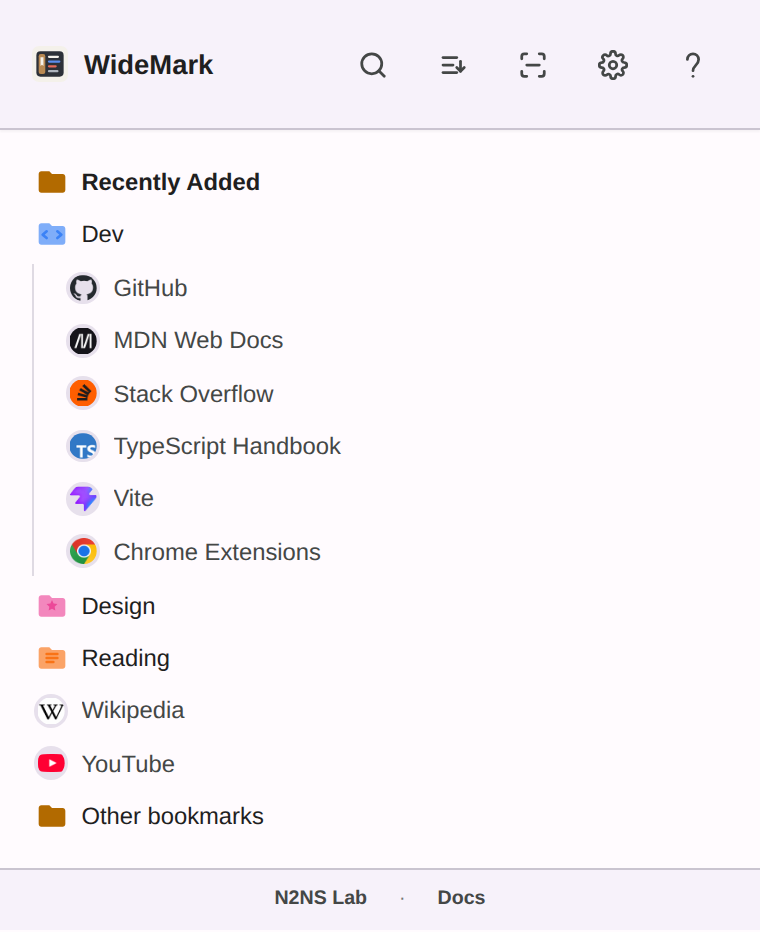

# WideMark

WideMark is a compact Chrome Manifest V3 bookmark manager for the side panel. It provides a persistent bookmark tree, fast search, folder styling, bookmark editing, drag-and-drop organization, and local duplicate-bookmark detection.

[Install from the Chrome Web Store](https://chromewebstore.google.com/detail/widemark-bookmark-side-pa/jmagjbdffihnegmhhpfdffceapdhlldh)



## Install manually (download from GitHub)

Use this if you cannot use the Chrome Web Store, or want a specific version. A manually installed copy works the same, but it does not update itself.

**Install**

1. Open the [Releases page](https://github.com/n2ns/chrome-widemark/releases) and, under **Assets** of the latest release, download `widemark-v<version>.zip`.
2. Unzip it into a folder you will keep, for example `Documents\WideMark` on Windows or `~/WideMark` on macOS and Linux. Chrome loads the extension from this folder every time it starts, so do not delete, move, or rename it.
3. In Chrome, open `chrome://extensions` (type it into the address bar).
4. Turn on **Developer mode** with the switch in the top-right corner.
5. Click **Load unpacked** and select the unzipped folder: the one that directly contains `manifest.json`.
6. Pin it: click the puzzle-piece icon in Chrome's toolbar, then the pin next to WideMark.

**Update**

1. Download the newer `widemark-v<version>.zip` from the Releases page.
2. Replace the files in your existing folder with the new ones. Make sure they end up in that same folder, not in a new one next to it:
   - Windows: right-click the zip, choose **Extract All…**, and set the destination to your existing folder. Confirm replacing the files.
   - macOS: double-clicking the zip creates a new folder next to it. Open that folder, select all its files, and drag them into your existing folder, choosing **Replace**.
   - Linux: `unzip -o widemark-v<version>.zip -d <your folder>`.
3. On `chrome://extensions`, click the reload arrow on the WideMark card.

WideMark keeps the same identity and settings wherever its folder is, but loading one folder and updating it in place keeps things simple.

**Remove**

On `chrome://extensions`, click **Remove** on the WideMark card. You can then delete the folder.

**Good to know**

- To Chrome, the manual copy and the Chrome Web Store version are the same extension. Use one or the other: remove the Chrome Web Store version before loading a manual copy. Removing it deletes WideMark's saved settings (such as theme, font size, spacing, zoom, and folder styles), so note them first.
- Chrome may remind you that extensions are running in developer mode. That is expected for manually installed extensions.

## Features

- Browse the full bookmark tree — Bookmarks Bar plus Other/Mobile Bookmarks — in Chrome's side panel.
- Search bookmarks and folders with multiple keywords across bookmark titles and URLs, or folder names. Results show their folder paths; use “Show in folder” to expand the original location and focus the item.
- Open bookmarks in the current tab, a foreground tab, or a background tab (middle-click supported).
- Create, edit, delete, reorder, and move bookmarks.
- Sort a folder's contents by name from the right-click menu.
- See a collapsible Recently Added section at the top of the tree.
- Navigate with the keyboard: Alt+B opens the panel, arrow keys walk the tree, `/` focuses search.
- Customize folder colors and icons.
- Adjust theme, font size, row spacing, and UI zoom.
- Find duplicate bookmarks locally, by exact URL or by shared domain.
- Clean up locally: delete empty folders and merge same-named sibling folders.

## Privacy And Permissions

WideMark uses only the permissions needed for bookmark-side-panel behavior:

```json
[
  "sidePanel",
  "bookmarks",
  "storage",
  "favicon"
]
```

It does not declare `host_permissions`. WideMark does not collect, track, or sell user data, and no data is sent to developer-operated servers. Bookmark browsing and duplicate checks are processed locally in Chrome. Folder style metadata is stored in Chrome Sync so those styles can follow the user's Chrome profile.

See [PRIVACY.md](PRIVACY.md) for the privacy policy.

## Development

Install dependencies:

```bash
npm install
```

Run checks:

```bash
npm run check
npm test
```

Build the unpacked extension:

```bash
npm run build
```

Build and sync it to the configured local Chrome test directory:

```bash
npm run build:sync
```

Create a Chrome Web Store upload package:

```bash
npm run package
```

See [docs/DEVELOPMENT.md](docs/DEVELOPMENT.md) for details.

## Documentation

- [Architecture](docs/ARCHITECTURE.md)
- [Development](docs/DEVELOPMENT.md)
- [Publishing](docs/PUBLISHING.md)
- [References](docs/REFERENCES.md)

## Project Layout

Built with React 19 + TypeScript, bundled by Vite (`@crxjs/vite-plugin`); UI
state in Zustand; bookmark logic is framework-agnostic and unit-tested.

```text
chrome-widemark/
├── manifest.json
├── vite.config.ts           # Vite + @crxjs build
├── tsconfig.json            # type-check only (Vite bundles)
├── src/
│   ├── background.ts        # MV3 service worker
│   ├── sidepanel.html       # React entry (#root + main.tsx)
│   ├── main.tsx  ·  App.tsx  ·  sidepanel.css
│   ├── components/          # React components
│   ├── stores/              # Zustand stores
│   ├── hooks/               # settings apply / keyboard / drag
│   ├── lib/                 # framework-agnostic bookmark logic
│   ├── types.d.ts  ·  chrome-shims.d.ts
│   └── styles/
├── build/                   # Vite output, git-ignored (Load unpacked here)
├── icons/  ·  store-assets/  ·  design/
├── scripts/  ·  test/  ·  docs/
```

## Status

This project intentionally avoids heavy process or framework overhead. See [TODO.md](TODO.md) for the current follow-up list.
